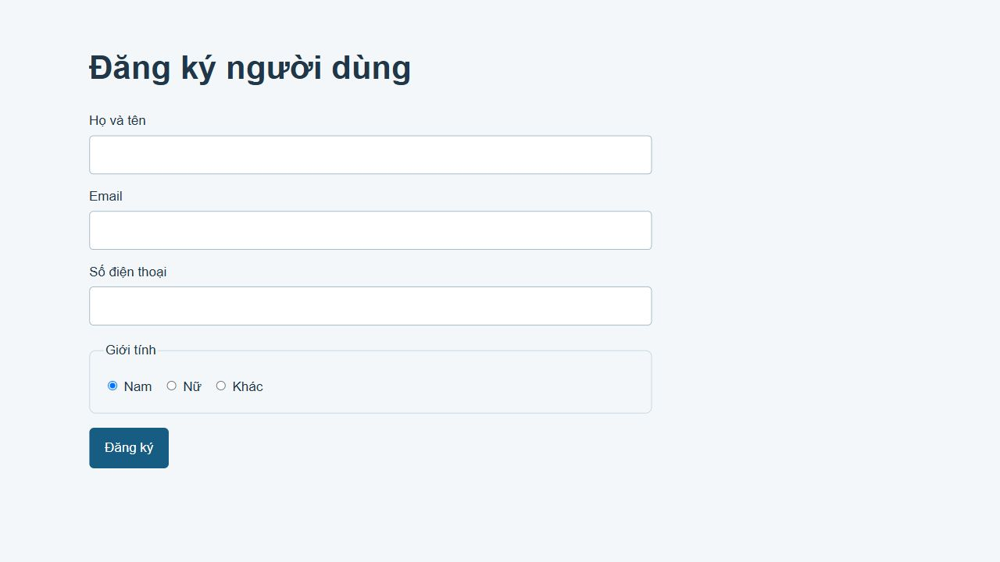

# [Bài tập] Tạo giao diện form đăng ký người dùng

Đề: https://internship.codegym.vn/learning/18/activity/1488

Mở index.html trong trình duyệt, giữ cấu trúc thư mục ảnh/CSS/JS. Mã được hoàn thiện với hỗ trợ AI. Dữ liệu người dùng, giá và phản hồi trên các giao diện mẫu là nội dung minh họa.

## Kết quả

Đúng action HTTP và POST theo đề: demo.codegym.vn/6/registration_form/register.php. Máy chủ mẫu có thể ngừng hoạt động; không thay đổi endpoint đề bài. Chỉ kiểm tra cấu trúc form và trường dữ liệu tại máy, không gửi dữ liệu người dùng thật.
