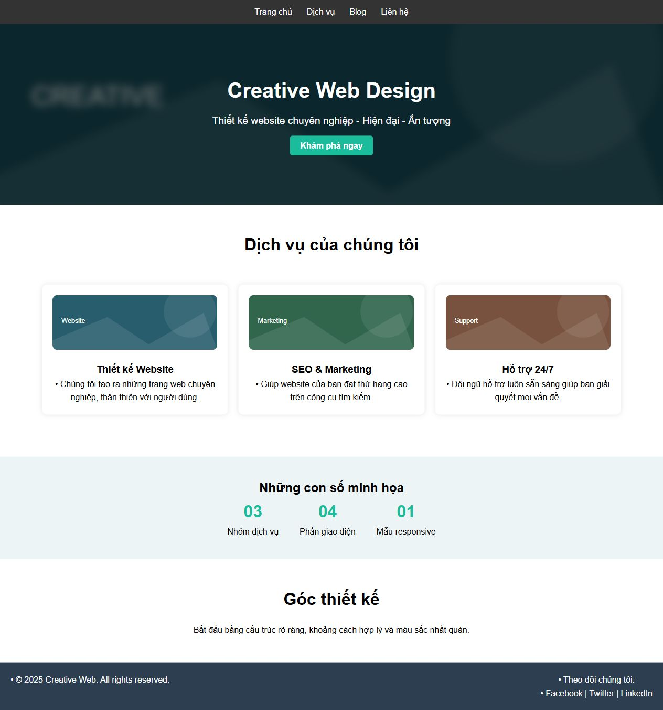

# [Bài tập] Tái cấu trúc mã CSS của các bài tập đã làm

Đề: https://internship.codegym.vn/learning/18/activity/1516

Mở index.html trong trình duyệt, giữ cấu trúc thư mục ảnh/CSS/JS. Mã được hoàn thiện với hỗ trợ AI. Dữ liệu người dùng, giá và phản hồi trên các giao diện mẫu là nội dung minh họa.

## Kết quả

Biên dịch: xem SCSS trong thư mục scss, CSS đầu ra trong css. Tại thư mục course18 chạy npm ci rồi npm run build:sass.

[Giải thích tái cấu trúc và nguồn](REFACTOR.md).
