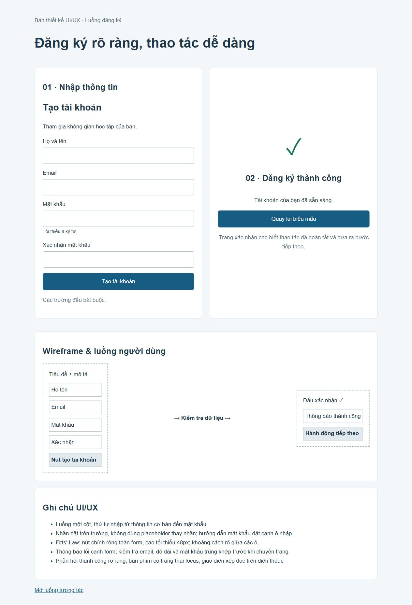

# [Bài tập] Thiết kế UI/UX giao diện trang đăng ký người dùng.

Đề: https://internship.codegym.vn/learning/18/activity/1518

Mở index.html trong trình duyệt, giữ cấu trúc thư mục ảnh/CSS/JS. Mã được hoàn thiện với hỗ trợ AI. Dữ liệu người dùng, giá và phản hồi trên các giao diện mẫu là nội dung minh họa.

## Kết quả

index.html là bản trình bày hai màn hình, wireframe và ghi chú UI/UX. form.html → success.html là luồng tương tác, kiểm tra mật khẩu khớp trước khi chuyển trang.
