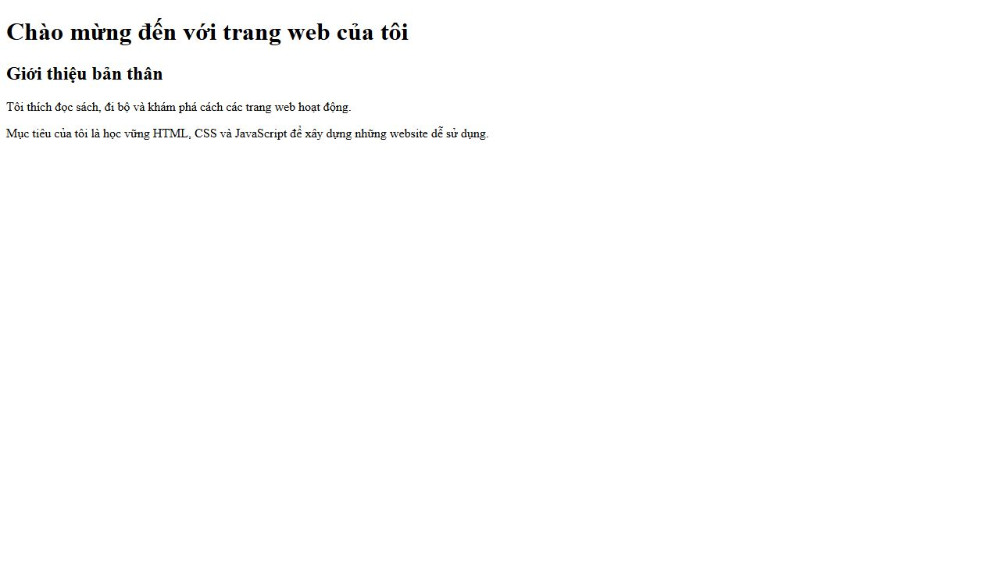

# [Bài tập] Sử dụng các thẻ tiêu đề và đoạn văn

Đề: https://internship.codegym.vn/learning/18/activity/1521

Mở index.html trong trình duyệt, giữ cấu trúc thư mục ảnh/CSS/JS. Mã được hoàn thiện với hỗ trợ AI. Dữ liệu người dùng, giá và phản hồi trên các giao diện mẫu là nội dung minh họa.

## Kết quả

