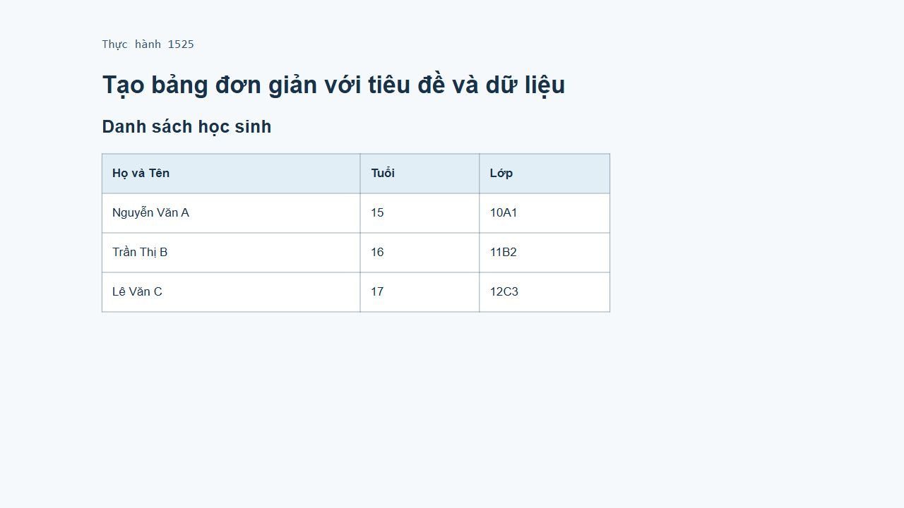

# [Thực hành] Tạo bảng đơn giản với tiêu đề và dữ liệu

Đề: https://internship.codegym.vn/learning/18/activity/1525

Mở index.html trong trình duyệt. Các bài có style.css/script.js cần giữ các file cùng cấu trúc thư mục.

Mã nguồn có sử dụng các ví dụ và hướng dẫn của CodeGym, được hoàn thiện và kiểm tra với hỗ trợ AI. Dữ liệu cá nhân/doanh nghiệp trên giao diện là dữ liệu minh họa.

## Kết quả trình duyệt

