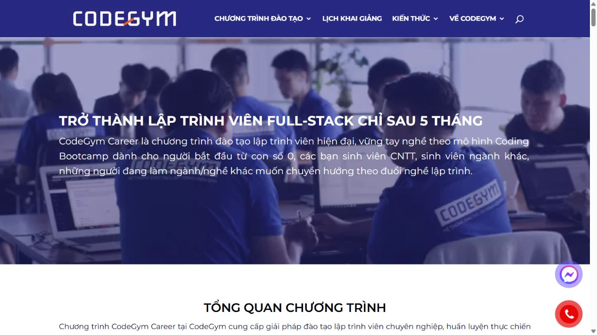

# Phân tích trang CodeGym Career

Nguồn được kiểm tra: https://codegym.vn/codegym-career/

- Header: logo bên trái và menu chương trình, lịch khai giảng, kiến thức, giới thiệu.
- Navigation: giúp đi đến các nhóm nội dung; thu gọn khi màn hình nhỏ.
- Content: hero giới thiệu chương trình, tổng quan, lợi ích, lộ trình, dự án, dịch vụ nghề nghiệp và CTA tìm hiểu chương trình. Nội dung sắp theo chiều dọc, một số nhóm dùng nhiều cột.
- Footer: thông tin liên hệ và các nhóm liên kết tài nguyên, giới thiệu.

Bản dựng giản lược giữ cấu trúc header/nav/content/footer, bốn liên kết nội bộ và bố cục chuyển sang một cột trên điện thoại.

