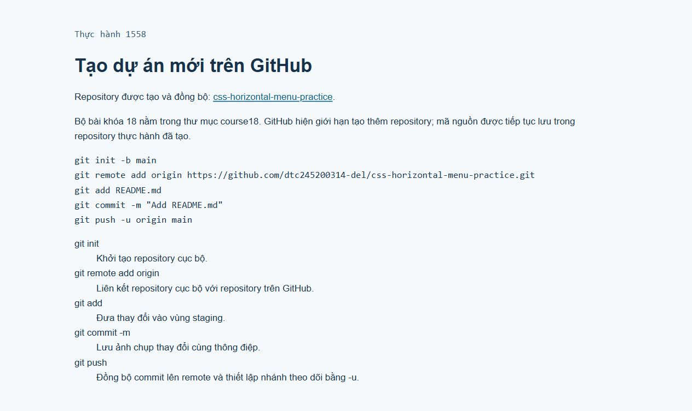

# [Thực hành] Tạo dự án mới trên GitHub

Đề: https://internship.codegym.vn/learning/18/activity/1558

Mở index.html trong trình duyệt. Các bài có style.css/script.js cần giữ các file cùng cấu trúc thư mục.

Mã nguồn có sử dụng các ví dụ và hướng dẫn của CodeGym, được hoàn thiện và kiểm tra với hỗ trợ AI. Dữ liệu cá nhân/doanh nghiệp trên giao diện là dữ liệu minh họa.

## Kết quả trình duyệt

## Các lệnh Git

- git init: tạo repository cục bộ.
- git remote add origin URL: liên kết remote GitHub.
- git add README.md: đưa file vào vùng staging.
- git commit -m "Add README.md": lưu thay đổi với thông điệp.
- git push -u origin main: gửi commit lên nhánh main và thiết lập nhánh theo dõi.

Repository css-horizontal-menu-practice đã được tạo và đẩy lên GitHub trước đó; bộ bài khóa 18 được lưu trong course18. Trong lần này GitHub trả về giới hạn tạo repository mới, nên tiếp tục dùng repository thực hành đã có.
