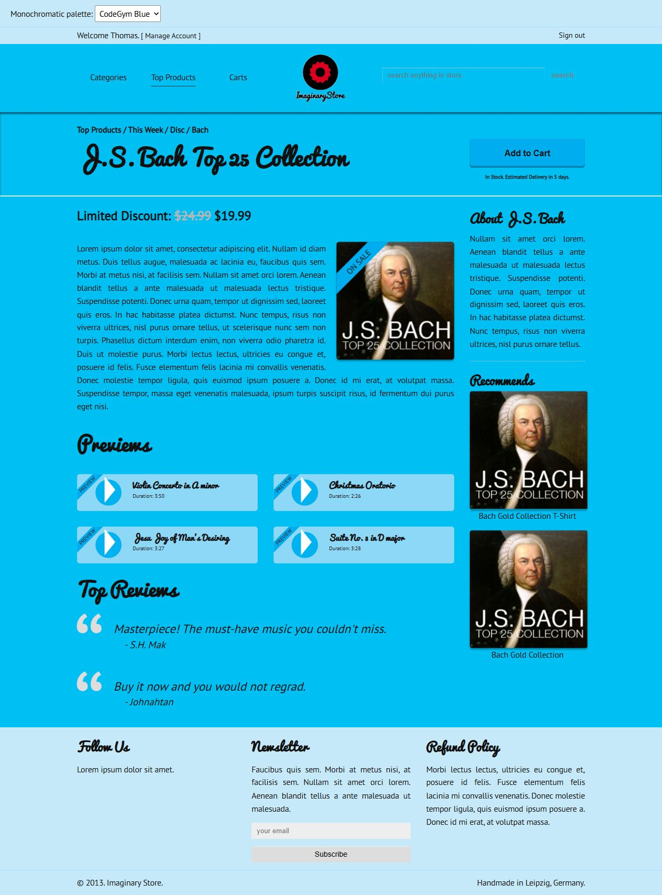

# Phối màu đơn tông

Dựa trên Pra.zip được CodeGym cung cấp. Giữ cấu trúc, font và hình ảnh gốc.

- Màu chính #00ADEE; màu cấp 2 #00B2EF.
- Nền #00BFF2; nội dung #8DD7F7; footer #C6E9FA.
- Chữ màu đen; badge ON SALE/PREVIEW theo màu chính.
- Chọn Forest Green để kiểm tra một bộ màu đơn tông khác.

Nguồn: https://github.com/codegym-vn/democodegym/blob/9cfdb957dc5976cce341eaa266bd2cb3b5aa8a0e/web/Pra.zip

## Kết quả trình duyệt

