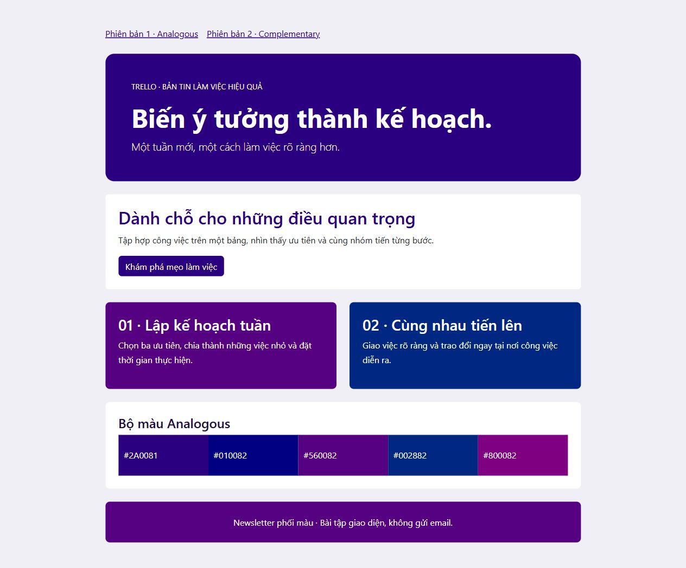

# [Bài tập] Phối màu cho newsletter

Đề: https://internship.codegym.vn/learning/18/activity/1668

Mở index.html trong trình duyệt, giữ cấu trúc thư mục ảnh/CSS/JS. Mã được hoàn thiện với hỗ trợ AI. Dữ liệu người dùng, giá và phản hồi trên các giao diện mẫu là nội dung minh họa.

## Kết quả

[Phiên bản 1](newsletter_version1.html) · [Phiên bản 2](newsletter_version2.html). Mã HEX và quy tắc chọn trong palettes.json. Ảnh Adobe Color trong ../evidence/1668-palette1.png và 1668-palette2.png.
