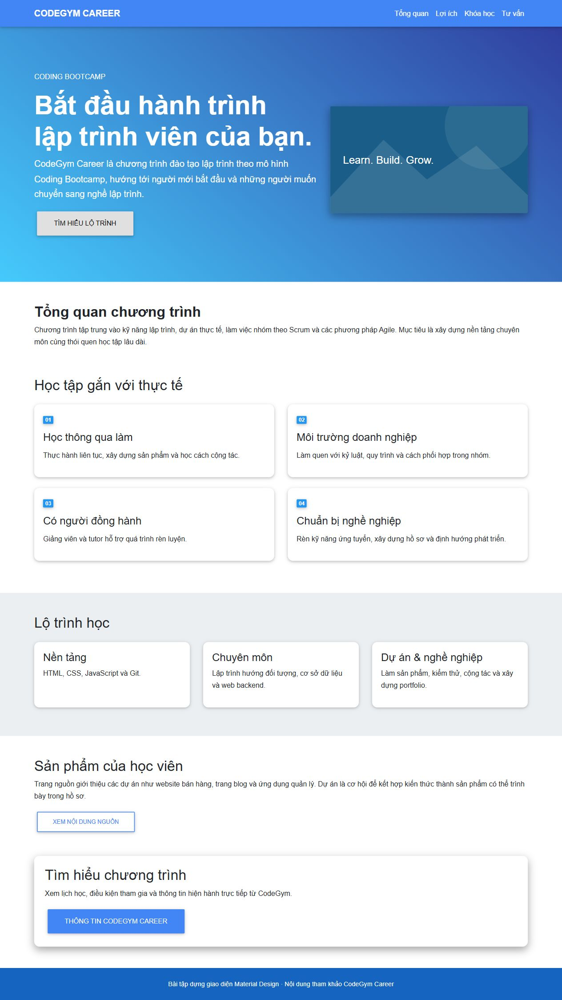

# [Bài tập] Xây dựng Landing Page

Đề: https://internship.codegym.vn/learning/18/activity/1669

Mở index.html trong trình duyệt, giữ cấu trúc thư mục ảnh/CSS/JS. Mã được hoàn thiện với hỗ trợ AI. Dữ liệu người dùng, giá và phản hồi trên các giao diện mẫu là nội dung minh họa.

## Kết quả

Nội dung tóm tắt từ https://codegym.vn/codegym-career/. Sử dụng Bootstrap 4.5.0 và MDBootstrap 4.19.1 đúng bộ CDN trong đề; không trộn JS Bootstrap 5. CTA dẫn đến trang thông tin thật, không gửi thông tin đăng ký.
