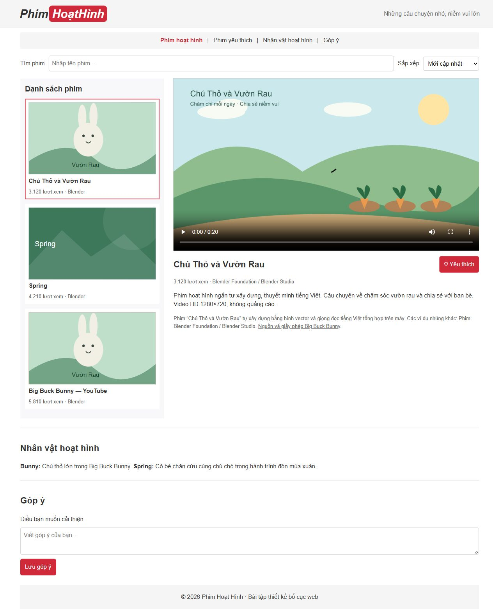

# [Bài tập] Phát triển trang web xem hoạt hình trực tuyến

Đề: https://internship.codegym.vn/learning/18/activity/1679

Mở index.html trong trình duyệt, giữ cấu trúc thư mục ảnh/CSS/JS. Mã được hoàn thiện với hỗ trợ AI. Dữ liệu người dùng, giá và phản hồi trên các giao diện mẫu là nội dung minh họa.

## Kết quả

Bố cục có tìm kiếm, sắp xếp, video HTML5, iframe YouTube, yêu thích và responsive. Video mặc định tự xây dựng, có thuyết minh tiếng Việt; các ví dụ iframe khác sử dụng phim Blender. Video/iframe phụ thuộc mạng và chính sách nền tảng.

Video mặc định Chú Thỏ và Vườn Rau là hoạt hình tự xây dựng HD 1280×720, có giọng đọc tiếng Việt tổng hợp Microsoft An. garden-story.mp4 và các nguồn SVG nằm trong repository, phát trực tiếp không phụ thuộc nguồn MP4 bên ngoài. Các mục YouTube là ví dụ nhúng iframe.
